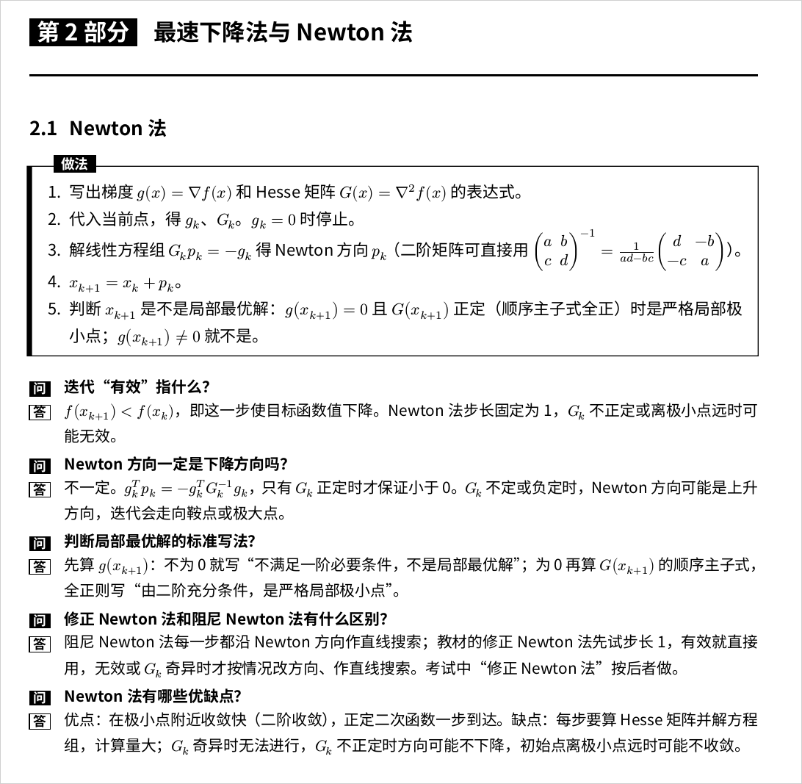
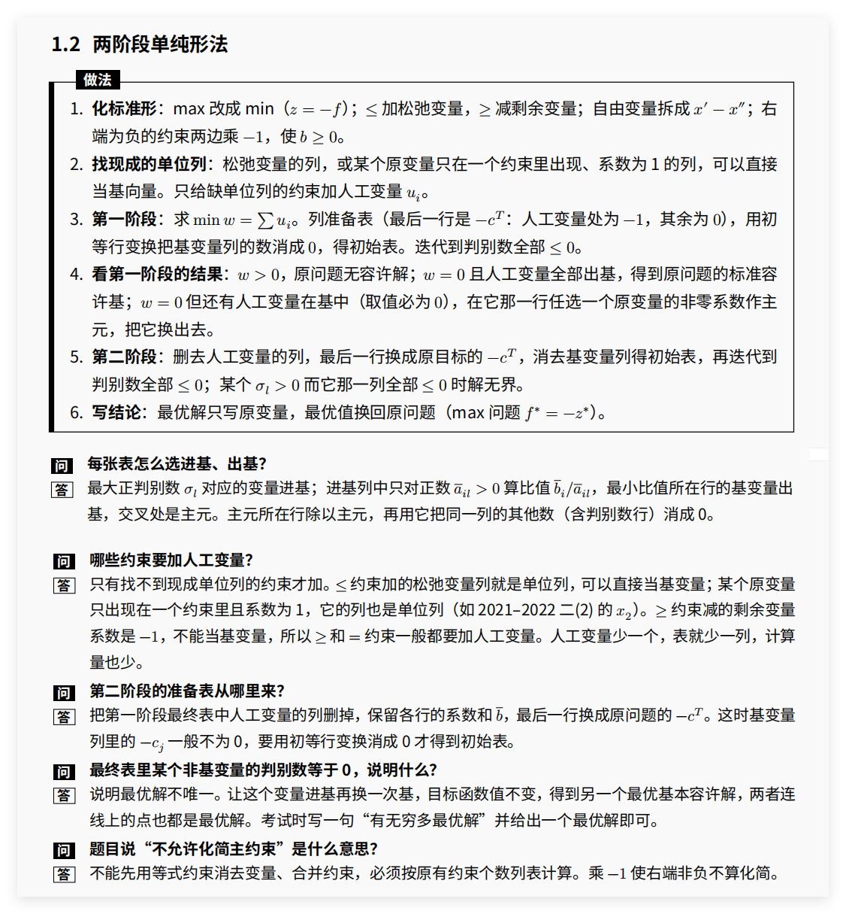
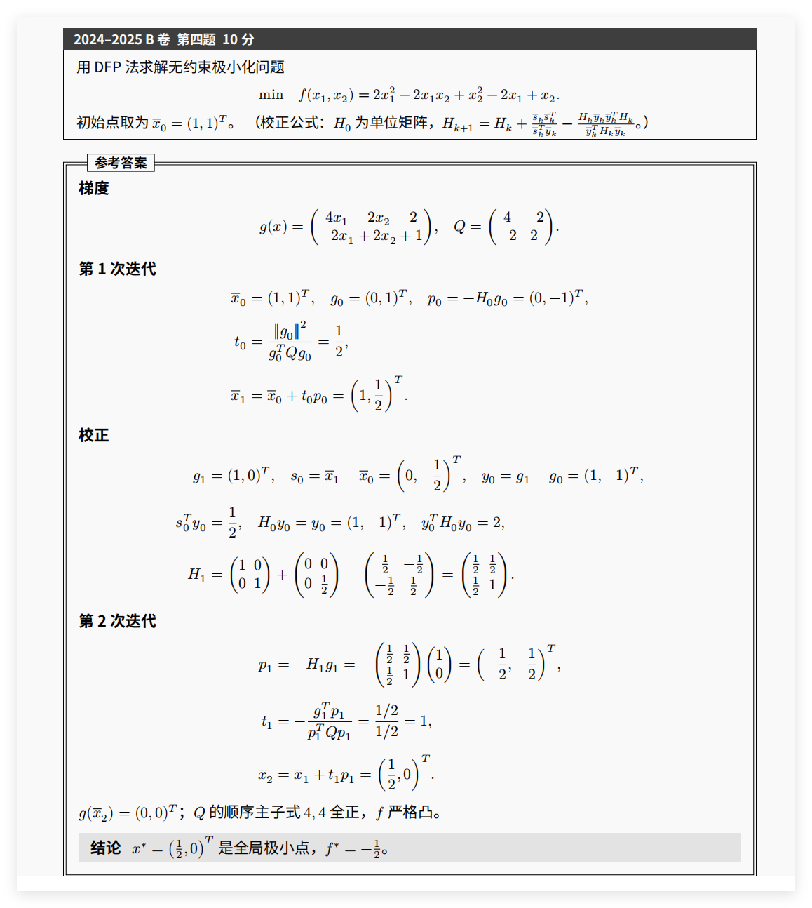
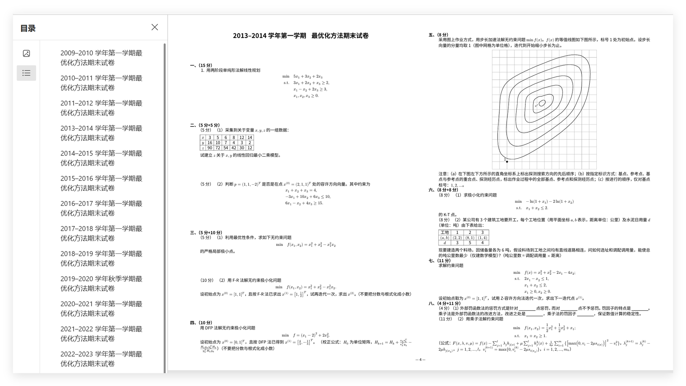

# 《最优化方法》期末真题参考解析

东北大学《最优化方法》2009–2025 年期末真题和预测题的参考解析，教材是张薇、薛嘉庆《最优化方法》。用 Typst 排版。

## 最优化方法_往年试卷_数字版.pdf

收录 2009–2025 年共 16 份期末试卷（含 24–25 A/B 卷，缺 12–13 学年）。按扫描版重排成文字版，每套一页，方便搜索；原卷配图重画成矢量图。

## 最优化方法_往年试题_参考解析.pdf

按教材章节分成 11 个专题，每个专题有解题步骤、常见问答、易错提醒和每道真题的完整解答。

| 章 | 专题 |
|---|---|
| 第一章 | ① 梯度、Hesse 矩阵与极值判定<br>② 凸集、凸函数与凸规划 |
| 第二章 | ③ 线性规划与单纯形法 |
| 第三章 | ④ 最速下降法与 Newton 法<br>⑤ 共轭梯度法<br>⑥ 拟 Newton 法<br>⑦ 步长加速法<br>⑧ 最小二乘问题（不在考试范围，但往年常考） |
| 第四章 | ⑨ 约束问题的最优性条件（K-T 条件）<br>⑩ Zoutendijk 容许方向法<br>⑪ 罚函数法与乘子法 |

## 编译

装好 Typst 后

```
typst compile --root . book/main.typ 最优化方法_往年试题_参考解析.pdf
typst compile --root . book/exams.typ 最优化方法_往年试卷_数字版.pdf
```

## 反馈

各位发现疏漏或有更好的写法，欢迎提 Issue 或 PR。
